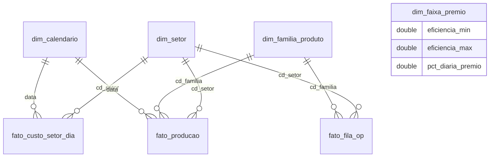

# 🏭 Dashboard de Produção e Meta por Setor (Power BI)

Projeto de portfólio em **Power BI** que acompanha a **meta de faturamento de cada setor de uma fábrica**, mostra se o setor está **no ritmo**, quanto falta para bater a meta, qual **faixa de prêmio** ele deve atingir e se a **fila de ordens de produção (OPs)** é suficiente para chegar lá.

> **Todos os dados são fictícios.** A "Metalúrgica Exemplo", seus setores, famílias de produto, custos e movimentações foram gerados por um script com semente fixa (`scripts/gerar_dados.py`). Nenhuma informação de empresa real foi usada. O projeto mostra a **lógica de modelagem e DAX** de um painel que desenvolvi, com todos os dados inventados.

## O que o painel responde

| Pergunta | Medidas principais |
| --- | --- |
| O setor está no ritmo para bater a meta do mês? | `Status`, `% Atual do Ciclo`, `Ideal Hoje` |
| Quanto falta e quanto precisa render por dia? | `Falta para Meta`, `Necessario por Dia`, `Esforco x Ritmo` |
| Onde o mês deve fechar mantendo o ritmo? | `Projecao Faturamento`, `% Projetado` |
| Qual faixa de prêmio o setor alcança? | `Faixa Premio Atual`, `Faixa Premio Projetada`, `Falta para Entrar no Premio` |
| A fila de OPs cobre a meta? Tem OP esquecida? | `Fila no Setor`, `Fila Cobre a Falta`, `OPs Paradas 15 Dias` |
| O mix de produtos ajuda ou atrapalha? | `Indice de Complexidade`, `% do Faturamento`, `Pontos de Eficiencia` |

## Modelo de dados

Esquema estrela com 3 fatos e 4 dimensões, mais uma tabela só para as medidas.



- `fato_producao`: movimentações de OP, com peças e valor do serviço.
- `fato_custo_setor_dia`: custo diário do setor (salários + prêmio estimado), **um registro por dia útil**.
- `fato_fila_op`: onde cada OP em aberto está agora e quanto vale o serviço restante.
- `dim_faixa_premio`: tabela **desconectada**, consultada pelas medidas de prêmio.
- `dim_calendario`: marca dia útil, com feriados.

## Decisões de modelagem que valem destaque

- **Custo com histórico.** O custo vive em um fato diário. Se o custo de um setor mudar hoje, os dias passados continuam com o valor que valia na época. Os dados sintéticos têm um reajuste de 5% em maio de 2026 para mostrar isso.
- **Data de referência no modelo.** Todo o acompanhamento parte de `Data Referencia`. No mock ela é fixa e o projeto roda em qualquer data. Em produção bastaria trocar por `TODAY()`.
- **Medidas organizadas em pastas** (`Acompanhamento da Meta`, `Composição da Meta`, `Prêmio`, `Fila de OPs`, `Mix de Produto`, `Velocímetro`), com descrição em cada uma.
- **Formatação condicional por medida** (`Cor Status`, `Cor Velocimetro`), sem cores fixas nos visuais.
- **Tabela de medidas separada** (`_Medidas`) e `discourageImplicitMeasures` ligado.

A lista completa está em [`docs/medidas.md`](docs/medidas.md).

## Como abrir

Requisitos: **Power BI Desktop** com a prévia de *Power BI Project (.pbip)* e *TMDL* habilitada (Opções > Recursos de visualização) e Python 3.

1. Gere os dados (opcional, os CSVs já vêm no repositório):
   ```bash
   python scripts/gerar_dados.py
   ```
2. Abra `MetalurgicaExemplo.pbip` no Power BI Desktop.
3. Em **Transformar dados > Gerenciar parâmetros**, ajuste `PastaDados` para o caminho da pasta `dados` na sua máquina e clique em **Atualizar**.

## Estrutura

```
├── dados/                          CSVs sintéticos
├── docs/medidas.md                 dicionário das medidas DAX
├── scripts/gerar_dados.py          gerador dos dados (semente fixa)
├── MetalurgicaExemplo.pbip
├── MetalurgicaExemplo.SemanticModel/   modelo em TMDL (tabelas, relacionamentos, medidas)
└── MetalurgicaExemplo.Report/          relatório
```

## Tecnologias

Power BI · DAX · Power Query (M) · TMDL / PBIP · Python

## Prints

_Em breve._

---

Feito por [Lucca Rocha](https://github.com/Lucskrr) · [LinkedIn](https://www.linkedin.com/in/lucca-rocha/)
